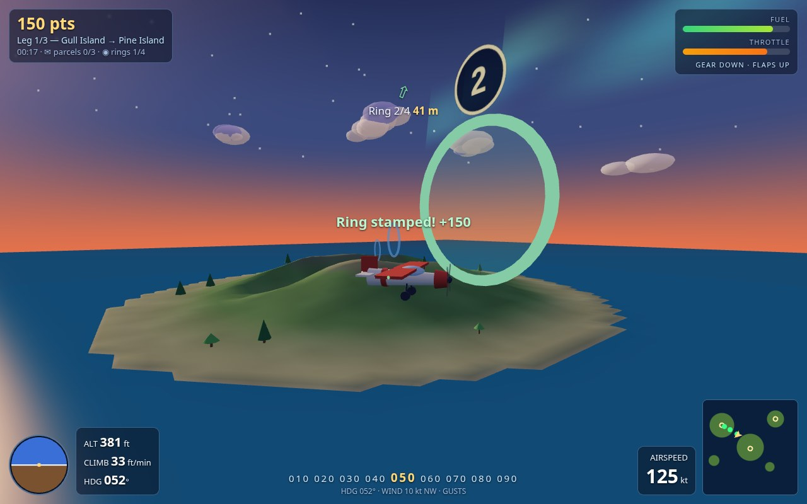

[](https://make.fun/c/best-flight-game-20261126-0057)
[](https://make.fun/c/best-flight-game-20261126-0057)
[](https://make.fun/c/best-flight-game-20261126-0057)

# SKYPOST — Aurora Mail Run

You are **Pip**, the last mail pilot of the northern archipelago. Dusk is falling, the
aurora is waking over the islands, and three island strips are waiting for their post.
Fly the rugged little mail plane **Kestrel** through the glowing mail rings, mind the
gusting north-westerly, and set her down gently on short island strips — the mail must
go through.

An entry for the [make.fun best flight game bounty](https://make.fun/c/best-flight-game-20261126-0057).



## How to play

Open `game/index.html` in a desktop browser, or serve the folder and open it:

```sh
node serve.ts
# then open http://localhost:8080
```

- **W / S** — throttle up / down. She needs 60+ kt before she will fly.
- **↑ / ↓** — pitch (pull up to climb, push down to descend).
- **← / →** — bank and turn. **A / D** — rudder.
- **Mouse** — hold and drag on the sky to steer like a stick; click all menu buttons.
- **F** — flaps (half, full) for slow flight and landing. **G** — landing gear.
- **C** — camera · **P** — pause · **M** — mute · **R** — restart the route.

A route is three legs — Gull Island → Pine Island → Lighthouse Rock → home. Each leg
stamps its glowing mail rings in order, then you land on the target strip: a soft
touchdown pays up to +400, a delivery +1000, each ring +150, and beating the 12-minute
par time pays a bonus. Fuel refills on every delivery; run dry and you are a glider.
Below 45 kt she stalls and wallows — keep the speed up, keep the nose down in a stall,
and never land gear-up on rough ground.

## What is in the sky

- A living dusk archipelago: six islands with heightfield terrain, beaches, pine and
  palm forest, harbour houses, and a lighthouse with a sweeping beam.
- A procedural aurora breathing across the northern sky, a low amber sun, early stars,
  and drifting clouds.
- Wind that gusts: a steady north-westerly plus slow gusts that push the plane sideways
  on final — crab into it or be blown off the centreline.
- A full cockpit: attitude indicator, altimeter, climb rate, compass tape, airspeed,
  fuel and throttle, a top-down minimap with the route, and a waypoint arrow with live
  distance.
- Synthesised sound, no audio files: the engine drone follows throttle and speed, wind
  rush follows airspeed, rings chime, deliveries jingle.

## Shots

The screenshots under `screenshots/` are real renders of the game's own code, staged
deterministically with `?shot=` (`shots.json` lists them): the mid-route cover (banking
through ring 2), the title screen, a final approach to Pine Island, and the route
complete card.

## Layout

- `game/` — the playable game as static files (`index.html` + ES modules under `src/`,
  one job per file; Three.js r149 vendored as `game/vendor/three.min.js`)
- `main.ts` — the hand-in program: copies `game/` and `screenshots/` to `/output` and
  writes `dossier.json`
- `vendor/makefun-game.ts` — the kit's dossier library, unchanged
- `screenshots/` — 4 screenshots of the game, taken from its own code
- `serve.ts` — a tiny static server for local play-testing
- `tools/` — the screenshot and closed-loop play-test drivers used to verify the game

All art is built in code with Three.js primitives and all sound is synthesised with the
Web Audio API — no images, no audio files, no network requests. The whole game is
static files under `game/`.

## License

MIT — see [LICENSE](LICENSE).
